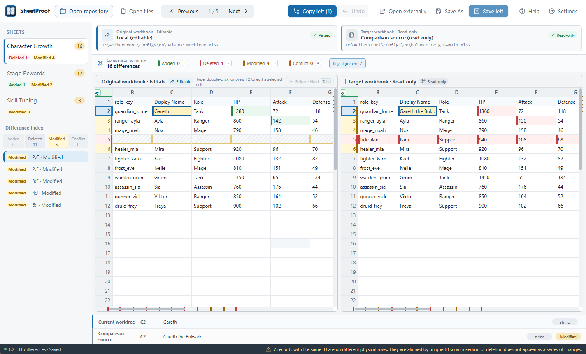

<!-- Generated from product facts and locale content. Do not edit directly. -->

[English](README.md) | [简体中文](README.zh-CN.md) | [日本語](README.ja.md) | Русский

# SheetProof

> Просмотр и применение изменений XLSX в Git.

SheetProof сравнивает книги .xlsx в рабочем дереве Git с проверенными версиями Git, выравнивает записи по ключу и переносит одобренные ячейки, строки или столбцы в редактируемую левую книгу.

Для разработчиков и контентных команд, которые просматривают версионированные конфигурационные книги. Файлы обрабатываются локально, Excel не требуется.

[](site/public/screenshots/ru/key-alignment.png)

_В демонстрации используются локализованные книги роста персонажа, наград за этапы и настройки навыков._

## Зачем нужен SheetProof

XLSX — сжатый OOXML-пакет. Текстовые сравнения принимают шум сериализации за изменения книги и не могут выборочно объединять ячейки с учётом контекста. SheetProof читает семантику книги в синхронные таблицы и оставляет за пользователем решение о том, что попадёт в левый результат.

## Выравнивание по ключу

SheetProof распознаёт общий заголовок `id` или единственный однозначный заголовок `*ID`. Ключевую колонку также можно выбрать из меню заголовка столбца. Записи с надёжным ключом выравниваются; неоднозначные записи откатываются к физическим строкам, не отключая выравнивание для остального листа. Односторонние записи остаются рядом с соседними общими записями.

## Текущие возможности

- **Сравнение с пониманием книги**: Сравнение листов, значений, формул, явных пустых значений и типов. Равенство ячеек не зависит от отображаемого форматирования.
- **Обзор бок о бок**: Синхронизированные виртуальные таблицы, навигация по фокусу и маркеры прокрутки для добавленных, удалённых, изменённых и конфликтных данных.
- **Работа с клавиатуры и системными инструментами**: Закрепляйте выбранные строки или столбцы, настраивайте шрифт интерфейса и масштаб таблицы в Настройках, правьте с клавиатуры и при необходимости используйте системный буфер обмена или приложение таблиц по умолчанию.
- **Выравнивание вставленных столбцов**: Надёжные уникальные текстовые заголовки выравниваются до сравнения, поэтому вставленный столбец остаётся локальным и не сдвигает все последующие.
- **Фильтры строк текущего листа**: Комбинируйте фильтры добавленных, удалённых, изменённых и конфликтных строк, не теряя просматриваемую исходную строку.
- **Поиск в текущем листе**: Независимый поиск по левой и правой сторонам с учётом регистра, целых Unicode-слов и регулярных выражений RE2, в том числе внутри отфильтрованных строк.
- **Справка в приложении**: Справка в панели рабочего стола показывает текущую версию, открывает руководство на активном языке и содержит сочетания клавиш.
- **Управляемое объединение и отмена**: Переносите выбранные ячейки, строки или целые столбцы правой стороны влево или удаляйте столбцы, существующие только слева; каждое структурное действие отменяемо.
- **Удержание для сравнения до и после**: Удерживайте «До/После» или Tab в таблице, чтобы увидеть левую книгу ровно такой, какой она была при открытии.
- **Английский, китайский, японский и русский**: Настольное приложение, CLI, документация, сайт и демонстрационные книги доступны на всех четырёх языках.
- **Режим локального Git-репозитория**: Чтение реального рабочего дерева с проверенной локальной или внешней отслеживаемой версией без checkout, fetch и переключения веток. Выбранные книга и версия загружаются до показа рабочей области.
- **Защищённое локальное сохранение**: Обнаружение внешних изменений, запись временного файла в том же каталоге, повторное открытие для проверки и атомарная замена оригинала.

## Загрузка

**0.9.0 Предварительная версия**

- [Windows amd64](https://github.com/tadazly/sheetproof/releases/download/v0.9.0/SheetProof-windows-amd64.exe)
- [macOS universal](https://github.com/tadazly/sheetproof/releases/download/v0.9.0/SheetProof-macos-universal.zip)
- [SHA256SUMS.txt](https://github.com/tadazly/sheetproof/releases/download/v0.9.0/SHA256SUMS.txt)
- [Source](https://github.com/tadazly/sheetproof/archive/refs/tags/v0.9.0.zip)

## Первое открытие в Windows и macOS

SheetProof сейчас является неподписанной предварительной версией, поэтому Windows и macOS могут показать предупреждение безопасности при первом открытии, потому что система не может проверить издателя. Само по себе это предупреждение не означает, что система обнаружила вредоносное ПО.

Скачивайте SheetProof только из GitHub Releases этого проекта. Если система явно сообщает о вредоносном ПО или повреждённом файле, остановитесь и скачайте файл заново.

### Windows

Текущий исполняемый файл не имеет кодовой подписи, поэтому Windows может определить его как нераспознанное приложение или показать неизвестного издателя.

1. Скачайте и дважды щёлкните `SheetProof-windows-amd64.exe`.
2. Если Windows сообщает, что защитила ваш компьютер, выберите **Подробнее**.
3. Выберите **Выполнить в любом случае**.

Если **Выполнить в любом случае** недоступна, работу приложения может блокировать Smart App Control или политика организации. Обратитесь к администратору; не отключайте средства безопасности Windows глобально только ради запуска SheetProof.

### macOS

Текущее приложение не подписано Apple Developer ID и не проходило нотаризацию, поэтому Gatekeeper не может автоматически проверить разработчика или статус нотаризации.

1. Скачайте и распакуйте `SheetProof-macos-universal.zip`.
2. Переместите `SheetProof.app` в **Программы**, затем дважды щёлкните его.
3. Если macOS блокирует запуск, откройте **Системные настройки → Конфиденциальность и безопасность**.
4. В разделе «Безопасность» найдите SheetProof, выберите **Открыть в любом случае**, пройдите проверку подлинности, затем выберите **Открыть**.

Если **Открыть в любом случае** не видно, попробуйте открыть SheetProof ещё раз и вернитесь в «Конфиденциальность и безопасность». Управляемый Mac может требовать одобрения администратора.

## Необязательная проверка скачивания

Для дополнительной проверки целостности сравните скачанный файл с `SHA256SUMS.txt` из того же GitHub Release.

**Windows**

```powershell
(Get-FileHash .\SheetProof-windows-amd64.exe -Algorithm SHA256).Hash
```

**macOS**

```bash
shasum -a 256 SheetProof-macos-universal.zip
```

Если значения не совпадают, не запускайте файл. Скачайте его заново из GitHub Releases.

## Быстрый старт

Откройте локальный Git-репозиторий или выберите две книги .xlsx. Левая сторона — единственный редактируемый источник; правая всегда только для чтения.

## Режим Git-репозитория

Режим репозитория читает реальное рабочее дерево слева и проверенный объект Git справа. Он не выполняет fetch, checkout, переключение веток, staging, commit или push.

## Режим двух файлов

Используйте экран приветствия или выполните `sheetproof compare --left current.xlsx --right target.xlsx`.

## UGit

Разместите приложение в постоянном месте, затем используйте «Настройку UGit». SheetProof заменяет только записи diff и merge для *.xlsx и проверяет результат. В настройках доступно сканирование папок: просматривайте и выбирайте репозитории со старыми переопределениями инструментов, затем подтверждайте массовое восстановление ассоциаций XLSX без открытия репозитория. Другие типы файлов и инструменты с подстановочными масками сохраняются.

## CLI

Текстовый вывод следует за `--lang en|zh-CN|ja|ru`; ключи JSON и значения перечислений остаются независимыми от языка.

## Известные ограничения

Поддерживается только .xlsx; .xlsm не поддерживается. SheetProof не является редактором уровня Excel и не гарантирует полной точности для диаграмм, изображений, сводных таблиц, внешних подключений или сложного условного форматирования.

## Сборка

Требуются Go 1.24+, Node.js 20+ и Wails 2.10.2. В Windows используйте `powershell -ExecutionPolicy Bypass -File scripts/invoke-wails.ps1 build`. Примечания GitHub Release генерируются из английского списка изменений и завершаются ссылками на списки изменений сайта на упрощённом китайском и японском.

## License

Лицензия MIT. Copyright (c) 2026 tadazly.
